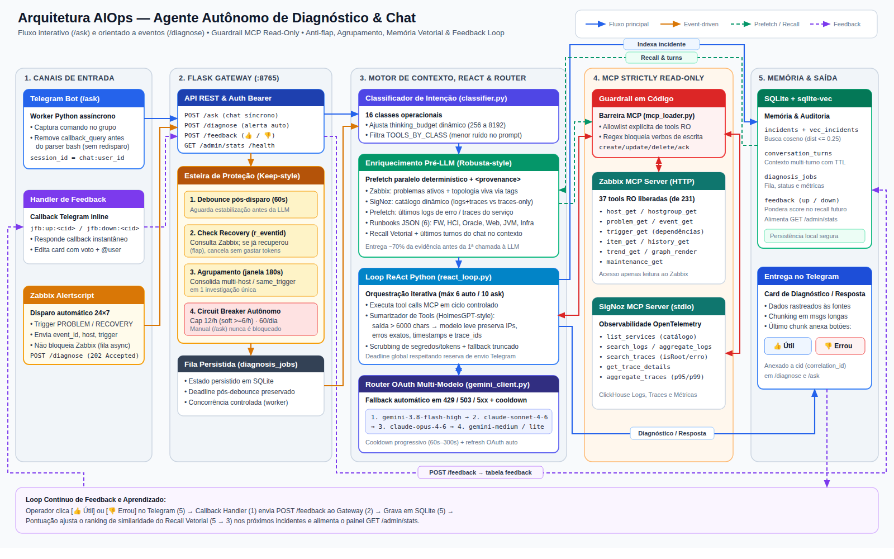

# Jarvis AIOps

> Read-only autonomous incident investigator and interactive SRE assistant for **Zabbix 7.0** and **SigNoz (OpenTelemetry)** via **Model Context Protocol (MCP)** — with multi-provider LLM routing, anti-flap correlation, vector memory, and Telegram feedback loops.

[Leia em Português (README.pt-BR.md)](./README.pt-BR.md)



---

## Why Jarvis AIOps?

Most MTTR is spent on repetitive manual triage before anyone touches a fix: checking host metrics, expanding trigger dependencies, correlating logs/traces, and figuring out whether an alert is real or a 30-second flap.

Jarvis AIOps embeds industry-proven patterns from **HolmesGPT**, **Robusta**, and **Keep** into a lightweight, self-hosted Flask + SQLite service:

- **Multi-Provider LLM Router (`app/llm_router.py`)**: Configure **Google Gemini** (`GEMINI_API_KEY`), **Anthropic Claude** (`ANTHROPIC_API_KEY`), **OpenAI / OpenRouter** (`OPENAI_API_KEY` + `OPENAI_BASE_URL`), or **local Ollama** (`OLLAMA_BASE_URL`). Automatically falls back across the model chain on `429`/`500`/`502`/`503` with progressive cooldowns.
- **Strictly Read-Only MCP Guardrails (`app/mcp_loader.py`)**: Explicit allowlist of 37 read-only Zabbix tools (out of 231+) plus regex/denylist mutation blocking across SigNoz and custom MCPs. Zero risk of accidental state changes during diagnosis.
- **Keep-style Noise Suppression (`app/memory.py`, `app/server.py`)**:
  - Configurable post-trigger **debounce** (`60s` default) while preserving full investigation deadline afterwards.
  - Pre-LLM **auto-recovery check** (`zabbix__event_get` verifying `r_eventid != '0'`) to cancel transient flaps at zero LLM cost.
  - Time-window **multi-host & same-trigger grouping** (`180s` default) collapsing alert storms into one investigation.
  - Autonomous **Circuit Breaker** (`12/hour` soft downgrade after `6/hour`, `60/day` hard cap) — never blocks interactive operator queries on `/ask`.
- **Robusta-style Deterministic Pre-fetch (`app/enrichment.py`)**: Reads live Zabbix Tier 1/2 topology tags (`tier`, `role`, `service`, `ingress`, `depends_on`, `app_host`), live SigNoz service catalog (separating `logs+traces` from `traces-only` proxies such as `traefik`), active problems, trigger dependency trees, and recent errors before iteration 1.
- **HolmesGPT-style Tool Summarization & Modular JSON Runbooks (`app/react_loop.py`, `app/runbooks/`)**: Large MCP outputs (`> 6,000` chars) are compacted by a fast model while strictly preserving IPs, errors, timestamps, and `trace_id`s; 6 modular JSON runbooks are matched dynamically by host/role/service/keywords.
- **SQLite + `sqlite-vec` Memory & 1-Click Feedback (`👍` / `👎`)**: Indexes completed diagnoses, tracks multi-turn chat history (`conversation_turns`), boosts/suppresses vector recall based on operator clicks in Telegram, and prevents `callback_query` bash polling loops via `--strip-callbacks`.

---

## Quick Start

### 1. Configure Environment

```bash
git clone https://github.com/virgiliojr94/jarvis-aiops.git
cd jarvis-aiops
cp .env.example .env
```

Edit `.env` and set at least:
- `JARVIS_AUTH_TOKEN` (generate with `openssl rand -hex 32`)
- One LLM credential (`GEMINI_API_KEY`, `ANTHROPIC_API_KEY`, `OPENAI_API_KEY`, or `OLLAMA_BASE_URL`)
- Your Zabbix MCP endpoint (`MCP_ZABBIX_URL`, e.g. from [`initMAX/zabbix-mcp-server`](https://github.com/initMAX/zabbix-mcp-server)) and/or SigNoz credentials (`SIGNOZ_URL`, `SIGNOZ_API_KEY`)

### 2. Run with Docker Compose

```bash
docker compose up -d --build
curl -sf http://localhost:8765/health
```

*(Optional SigNoz MCP binary: build with `--build-arg INSTALL_SIGNOZ_MCP=true` or mount a binary at `./bin/signoz-mcp-server:/usr/local/bin/signoz-mcp-server:ro`.)*

### 3. Run Locally (Development / Tests)

```bash
python3 -m venv .venv && source .venv/bin/activate
pip install -r requirements.txt
for f in tests/test_*.py; do python3 "$f"; done
```

---

## HTTP API

All endpoints except `/health` and `/readiness` require `Authorization: Bearer <JARVIS_AUTH_TOKEN>`.

| Endpoint | Method | Purpose |
|---|---|---|
| `/health` | `GET` | Liveness check (`{"status": "ok"}`) |
| `/readiness` | `GET` | Checks LLM chain, SQLite memory, and configured MCPs |
| `/ask` | `POST` | Interactive ReAct investigation (`{"question": "...", "session_id": "chat:user"}`) |
| `/diagnose` | `POST` | Event-driven Zabbix trigger diagnosis (`async: true` queues with Keep protections) |
| `/feedback` | `POST` | Records operator rating (`correlation_id`, `rating`: `up`/`down`) |
| `/admin/stats` | `GET` | Returns queue counts, feedback totals, recent runs, and indexed incidents |
| `/admin/reload-prompt` | `POST` | Hot-reloads prompt files from disk without restarting |

### Example `/ask` Call

```bash
curl -s -X POST http://localhost:8765/ask \
  -H "Authorization: Bearer $JARVIS_AUTH_TOKEN" \
  -H "Content-Type: application/json" \
  -d '{"question": "Which services have high p95 latency in the last 30 minutes?"}'
```

### Example Autonomous `/diagnose` Webhook Payload

```bash
curl -s -X POST http://localhost:8765/diagnose \
  -H "Authorization: Bearer $JARVIS_AUTH_TOKEN" \
  -H "Content-Type: application/json" \
  -d '{
    "async": true,
    "event_id": "9001",
    "host": "app-node-01",
    "host_id": "10501",
    "severity": "Disaster",
    "trigger_name": "High 5xx error rate on checkout-api"
  }'
```

*(Pass `"event_status": "RESOLVED"` or `"value": "0"` when Zabbix recovers to cancel queued jobs during the debounce window.)*

---

## Telegram Integration (`integrations/telegram/`)

- `batbot_worker.py`: Sends `/ask` queries with conversation `session_id`, chunks HTML responses safely for Telegram's 4096-char limit, and attaches inline `👍 Helpful` / `👎 Wrong` buttons on the final chunk.
- `feedback_callback.py`: Processes inline button callbacks (`--from-updates` / `--handle-json`), posts to `/feedback`, updates the message markup with the reviewer handle, and includes `--strip-callbacks` so legacy `getUpdates` bash bots never mistake `reply_to_message.text` inside a callback for a new command.
- `zabbix_call.sh`: Minimal bash wrapper for CLI or Zabbix scripts.

---

## Configuration Tips

- **Bilingual Prompts**: Set `JARVIS_LANGUAGE=en` (default) or `JARVIS_LANGUAGE=pt-BR` to load `app/prompts/system-prompt.{en|pt}.txt` and `ask-prompt.{en|pt}.txt`, or override paths via `JARVIS_SYSTEM_PROMPT_FILE` / `JARVIS_ASK_PROMPT_FILE`.
- **Custom Runbooks**: Drop any `.json` file into `app/runbooks/` matching `hosts`, `roles`, `groups`, `services`, or `keywords`.
- **Model Chain**: Override `JARVIS_MODEL_CHAIN` with comma-separated specs such as:
  `JARVIS_MODEL_CHAIN=gemini:gemini-2.5-flash,anthropic:claude-sonnet-4-5,ollama:qwen2.5:14b`

---

## License

[MIT](./LICENSE)
