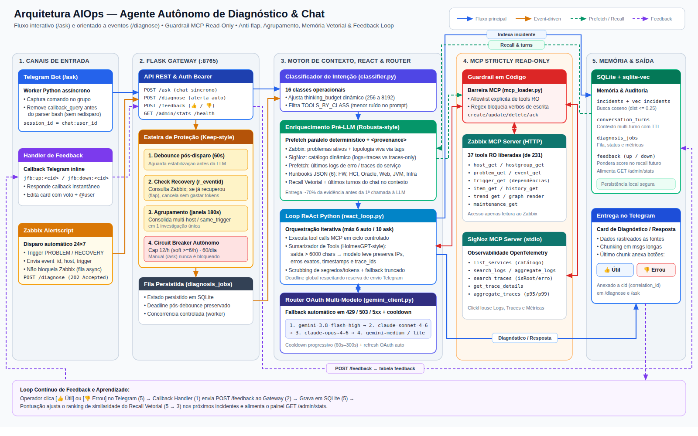

# Jarvis AIOps

> Agente AIOps autônomo (read-only) de investigação de incidentes e chat SRE para **Zabbix 7.0** e **SigNoz (OpenTelemetry)** via **Model Context Protocol (MCP)** — com router multi-provedor, supressão anti-flap, memória vetorial e loop de feedback no Telegram.

[Read in English (README.md)](./README.md)



---

## Principais Recursos

- **Router LLM Multi-Provedor (`app/llm_router.py`)**: Suporte nativo a **Google Gemini** (`GEMINI_API_KEY`), **Anthropic Claude** (`ANTHROPIC_API_KEY`), **OpenAI / OpenRouter** (`OPENAI_API_KEY` + `OPENAI_BASE_URL`) e **Ollama local** (`OLLAMA_BASE_URL`), com fallback automático em `429`/`500`/`502`/`503` e cooldown progressivo.
- **Guardrail MCP Estritamente Read-Only (`app/mcp_loader.py`)**: Allowlist explícita de 37 ferramentas somente leitura do Zabbix (de 231+) e bloqueio por regex/denylist de verbos de escrita no SigNoz e demais MCPs.
- **Esteira Anti-Ruído estilo Keep (`app/memory.py`, `app/server.py`)**:
  - **Debounce pós-disparo** (`60s` padrão) preservando integralmente o prazo de investigação após acordar.
  - **Check pré-LLM de recovery** (`zabbix__event_get` conferindo `r_eventid != '0'`) cancelando flaps antes de gastar tokens.
  - **Agrupamento multi-host e `same_trigger`** (`180s`) consolidando quedas simultâneas em uma única análise.
  - **Circuit Breaker autônomo** (`12/h` com downgrade após `6/h` e teto `60/dia`) sem nunca bloquear comandos manuais no `/ask`.
- **Enriquecimento Determinístico Pré-LLM estilo Robusta (`app/enrichment.py`)**: Lê topologia viva via tags do Zabbix (`tier`, `role`, `service`, `ingress`, `depends_on`, `app_host`), descobre dinamicamente o catálogo do SigNoz (diferenciando serviços `logs+traces` de proxies `traces-only` como `traefik`), e injeta problemas ativos, árvore de dependências e erros recentes antes da iteração 1.
- **Compactação estilo HolmesGPT + Runbooks JSON (`app/react_loop.py`, `app/runbooks/`)**: Saídas > `6.000` chars são compactadas por modelo leve preservando IPs, erros, timestamps e `trace_id`s; 6 runbooks JSON modulares carregados sob demanda.
- **Memória Vetorial SQLite (`sqlite-vec`) + Botões `👍`/`👎` no Telegram**: Indexa diagnósticos, mantém turnos conversacionais por chat, ajusta peso no recall conforme feedback humano e evita loop de redisparo no `getUpdates` com `--strip-callbacks`.

---

## Como Subir Rapidamente

```bash
git clone https://github.com/virgiliojr94/jarvis-aiops.git
cd jarvis-aiops
cp .env.example .env
# Preencha JARVIS_AUTH_TOKEN, idioma (JARVIS_LANGUAGE=pt-BR), sua chave de LLM e URLs MCP
docker compose up -d --build
curl -sf http://localhost:8765/health
```

### Rodando os testes locais

```bash
python3 -m venv .venv && source .venv/bin/activate
pip install -r requirements.txt
for f in tests/test_*.py; do python3 "$f"; done
```

---

## Endpoints REST (`:8765`)

Todos os endpoints (exceto `/health` e `/readiness`) exigem `Authorization: Bearer <JARVIS_AUTH_TOKEN>`.

- `POST /ask`: Investigação interativa read-only com contexto conversacional (`session_id`).
- `POST /diagnose`: Diagnóstico automático de eventos Zabbix (`async: true` habilita fila SQLite, debounce, check `r_eventid`, agrupamento e Circuit Breaker).
- `POST /feedback`: Registra voto `up`/`down` e atualiza `feedback_score` no SQLite.
- `GET /admin/stats`: Estatísticas operacionais da fila, feedbacks e incidentes indexados.
- `POST /admin/reload-prompt`: Recarrega arquivos de prompt sem reiniciar o container.

---

## Licença

[MIT](./LICENSE)
